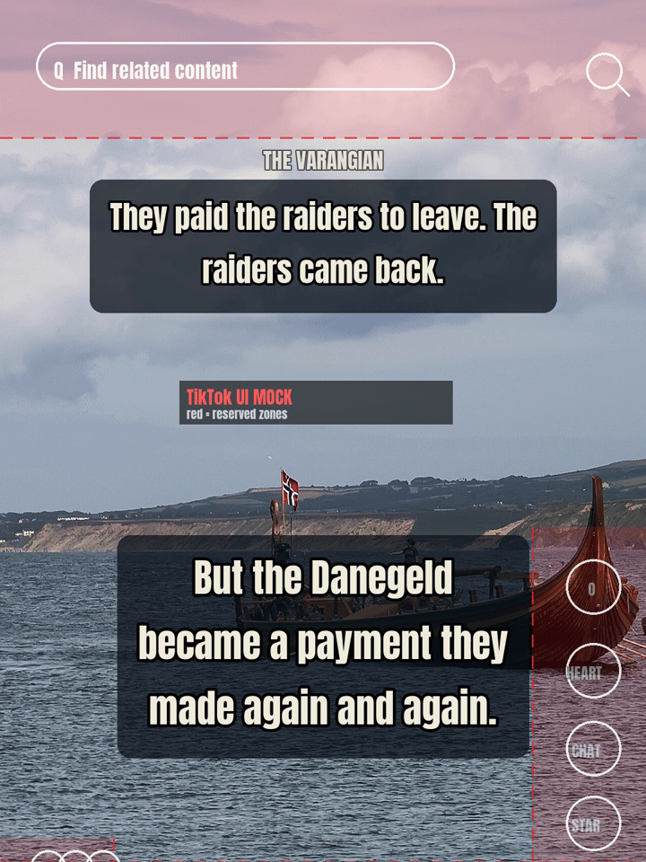

There's a TikTok channel called **THE VARANGIAN** that tells Viking-age history as
security lessons — one true raid, one lesson in how you'd defend against it. The tagline is
the whole thesis of authorized offensive security in six words: **"Hired to break in. Sworn
to guard."**

I didn't edit a single frame of it. A crew of AI agents built the pipeline that makes the
clips — the fact-checking, the licensing, the rendering, the nightly loop — each shipping
its work as a pull request I reviewed and merged. The second post, the Varangian Guard of
988, did about **102K views in roughly eight hours** (owner-reported — more on why I can't
prove that number later).

The views are the hook. The honest part — the part worth a blog post — is *how a pile of
agents built a working content factory in a few days, and everything that broke on the way.*

<!--cut-->

* TOC
{:toc}

# The concept: history as a pentest

The real Varangian Guard were hired Norse and Rus raiders who swore an oath to protect the
Byzantine throne — foreign breakers paid to guard the thing everyone else wanted to sack.
That's not a loose metaphor for authorized offensive security. That *is* authorized
offensive security: hired to break in, sworn to guard.

So every clip is a two-beat unit. Beat one is a true event — Portland c. 789, the Danegeld,
the Guard at the walls of Constantinople. Beat two is the security lesson it teaches, framed
constructively, defense-first. The violence is never the point; the point is always what you
should have done about it.

A few guardrails are load-bearing, not decoration:

- **Accuracy is the brand.** The history crowd punishes loose claims, so every factual line
  on screen carries a source, saga-only material is phrased "the sagas say," and a few
  standing corrections are pinned: Lindisfarne (793) was *not* the first raid — Portland came
  first; the leader at Paris in 845 is **Reginherus** in the primary source, not "Ragnar";
  and the famous "emperor's wine-bags" line has no primary source, so it never gets quoted as
  fact.
- **It's deliberately anti-extremist.** The Varangians were a multi-ethnic guard serving a
  cosmopolitan empire — service and oath, not blood-and-soil. That reading is the strongest
  inoculation against the ugly corner of this aesthetic, and the channel leans into it on
  purpose.
- **It launched faceless.** Real history visuals, on-screen story text, a music bed. No
  on-camera anyone.

# The crew that builds it

The agents run under an open-source orchestrator I've been building called
[**Firstmate**](https://github.com/kunchenguid/firstmate): a "first mate" that supervises a
persistent producer agent and spins up short-lived task workers under it. The shape is
deliberately boring and boringly safe:

- I describe what I want in plain language.
- A worker gets an **isolated git worktree** — a disposable copy of the repo — and does the
  job there. It can install, run, break, and throw away whatever it likes; none of it touches
  my real checkout.
- It opens a **pull request** and reports back.
- **I review and merge.** Every single one.

Ten PRs built THE VARANGIAN's factory, from the first "local clip pipeline MVP" to "make the
morning page actually publish instead of lying about it." The agents never posted anything,
never logged into anything, never spent a cent — by rule. They write code and stage media; a
human ships.

# The clip pipeline, start to finish

The product is a **Raid Report**: a ~20–45-second vertical clip that tells one story in
on-screen text over historical imagery, with a music bed. Here's the assembly line a single
clip rides, all of it local — no SaaS, no paid APIs, no network at build time:

1. **A sourced story.** Each report is a small manifest — the on-screen beats, the shot list,
   the caption — with its sources attached. No source, no story.
2. **A fact-check gate that can kill the clip.** Before anything renders, every factual beat
   runs an adversarial hard gate. It enforces the standing corrections, demands a source on
   every claim, and (optionally) turns a reasoning model loose to actively try to *falsify*
   each line. One failed claim and the story is **killed — never built, never shipped.**
3. **A brand-safety blocklist.** A lint pass checks all the text against a defensive blocklist
   of hate-coded symbols and terms. A banned term fails the row outright and records it as
   rejected. (The lint reads text only — imagery still gets a human eye, see below.)
4. **Free-licensed footage, with credits.** Only public-domain / CC0 / CC BY / CC BY-SA
   media, each with its source, license, and attribution recorded, and a full credits line
   built for the post. Real topical *video* of the Viking age barely exists, so most shots
   are high-resolution stills.
5. **Ken Burns on the stills.** Each still is animated with a slow documentary pan-and-zoom
   and cut into the sequence like a video shot — no black bars, motion sampled down from a
   high-res canvas so it stays smooth.
6. **A music bed, mixed and normalized.** Owned or royalty-free only, loudness-normalized for
   social (~-14 LUFS). Never a trending or charting track off-platform — that matters, and
   it's the one thing that forces a human into the loop (next section).
7. **Render + a phone copy.** ffmpeg emits a 1080×1920 H.264 clip to spec, then a smaller
   phone-playable copy for review.
8. **The nightly 05:30 loop.** A scheduled job (a macOS LaunchAgent) runs the whole thing
   unattended so that by about 7 AM there's a single clip waiting — early enough to beat the
   deadline, with margin for ~8–12 minutes of ffmpeg.
9. **A private morning review page.** On my phone I get a private page with the day's clip:
   play it inline, **Save video** straight to Photos, copy the caption and the credits line,
   read the beats and the fact-check PASS badge, **Mark posted** when it's up, and steer
   tomorrow with *more like this* / *kill that*.
10. **One a day.** There's a backlog of approved clips, but they surface **one per day** on a
    rotation — a bulk dump goes stale. Posting is a human tapping buttons at a human cadence.

# What broke (and how we fixed it)

If I only told you the clean version, I'd be breaking my own rule. Here's the honest list.

**1. Music that sounded like silence.** The early clips had a music bed that measured fine on
paper (~-14 LUFS) and was still *inaudible on a phone.* The bed was a self-synthesized sine
pad — energy stacked at 110/165/220 Hz under a lowpass, with almost nothing above ~300 Hz.
That's exactly the band a phone speaker throws away. In the phone-reproducible range the old
bed sat around **−33 dB** — a whisper. The fix was swapping in real, broadband, royalty-free
instrumentals (CC-BY cues), which lifted the phone band by **+11 to +13 dB** with the overall
loudness unchanged. The carved-in lesson: **loudness is not audibility.** A sub-heavy master
can eat the whole −14 LUFS budget and leave nothing a phone can actually play, so the channel
now prefers mid-forward masters — drums and strings, not bass.

**2. Two stories stacked on top of each other.** The first Raid Report demo rendered a clip
with *two* captions fighting on screen. The render logic was correct — it drew the report's
own hook for the first ~3 seconds and nothing more. The problem was the footage: the
stand-in B-roll was a *finished clip from an earlier task* that already had its hook text
**burned in**. Overlaying a fresh report stacked two text layers. Root cause: the footage,
not the pipeline. Fix: only ever feed clean, un-captioned source. Obvious in hindsight;
invisible until you watch the actual pixels.

**3. The publish that lied.** The nightly loop's last step publishes the morning page. For a
while that was a single unattended command whose exit code I trusted. An end-to-end test
caught it exiting **success while doing absolutely nothing** — the page was never updated, no
clip uploaded — and still printing `page-sync complete`. Two root causes, both confirmed: the
headless CLI running that step **doesn't even have the tool** that publishes the page (those
tools are injected by the app host, not built into the bare CLI), and the command **exits 0
on a no-op** because a finished message isn't a finished *task*. The fix splits the step into
a deterministic **build**, a networked **publish**, and a **verify** that refuses to pass
unless it can prove a real update landed — same page URL, an asset for every clip, published
today. Now a silent no-op **fails loud** instead of lying. This one's the most
security-brained bug of the batch: *green is the absence of an error, not the presence of a
result.*

**4. Captions hiding under TikTok's own buttons.** Once real posts were up, screenshots
showed the on-screen text colliding with TikTok's UI. The right-hand action column
(like/comment/save) clipped the end of a line — "needed men" got eaten. The left-side liker
bubbles covered "Easter" and "rowed." And when a video opens from search, TikTok's search bar
sits right over the top band where the title lives. Fixes, all in the render path: narrow the
caption column to a centered safe zone clear of *both* side overlays, drop the top band below
the search-bar zone, and **pin the title** so it stays legible for the whole clip (full-size
for the first few seconds, smaller but present after). To check it before shipping, the crew
renders a preview with a **mock of the TikTok chrome drawn on top** — search bar, action
column, caption strip — so you can see the clip clears all of it.

# What stays deliberately human

Automation has a hard seam in it, on purpose:

- **A human adds the sound and posts every clip.** A trending sound's license attaches *only*
  when you add it in-app from the platform's own library — you can't lawfully mux a charting
  track off-platform. That licensing wall is exactly what forces a person into the loop, and
  it's a feature: it keeps every clip original and keeps a human hand on the publish button.
- **I approve every story.** The fact-check gate and brand-safety lint are the machine floor,
  not the ceiling. I'm the last sign-off, especially on imagery — the lint reads text, so it
  can't see a bad symbol *in a picture*. Every visual gets a human eye.
- **No growth-hacking.** No bought followers, no bots, no bulk auto-posting of templated
  clips. A human posts at a human cadence.

# Results so far — and the honest caveat

So far: the Varangian Guard (988) clip did about **102K views in ~8 hours**; the Danegeld
clip was sitting around **756** at the same check. Here's the caveat I owe you, because the
whole channel is built on *facts not opinions*: **those numbers are owner-reported.** The
pipeline deliberately never calls a platform API, so it stores no analytics — I read those
off the app with my own eyes, not out of a database. It's also days old and a tiny sample;
one clip finding a feed is not a trend.

What I'll actually stand behind is the smaller claim: a crew of AI agents, supervised and
merged by one human, stood up a real, auditable, license-clean content pipeline — with a
fact-check gate that can kill a story and a publish step that can no longer lie — in a few
days. The 102K was a good morning. The machine that made it is the point.

If this channel ever drops a clip that reads a little *too* clean — sourced, fact-checked,
framed as a lesson — now you know what's under the hood.

Hired to break in. Sworn to guard. Let's go to work.

---

*⚒ j1v37u2k3y · [jiveturkey.rocks](https://jiveturkey.rocks/)*
